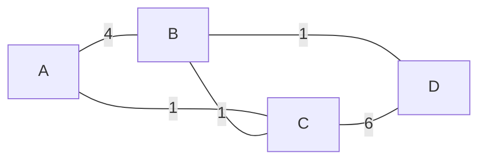

# СР №12

| ребро | вага |
|---|---|
| A-B | 4 |
| A-C | 1 |
| B-C | 1 |
| B-D | 1 |
| C-D | 6 |

## 1

ваги ігноруються, кожне ребро має вагу 1

найкоротший шлях за ребрами - A-B-D, 2 переходи

шлях A-C-D теж має 2 переходи, тобто це рівність, і за контрольним скриптом береться A-B-D

## 2

алгоритм Дейкстри, відстань джерела 0, решти нескінченність

| крок | опрацьований вузол | dist A | dist B | dist C | dist D |
|---|---|---|---|---|---|
| 0 | - | 0 | ∞ | ∞ | ∞ |
| 1 | A, відстань 0 | 0 | 4 | 1 | ∞ |
| 2 | C, відстань 1 | 0 | 2, тобто 1 + 1 | 1 | 7, тобто 1 + 6 |
| 3 | B, відстань 2 | 0 | 2 | 1 | 3, тобто 2 + 1 |
| 4 | D, відстань 3 | 0 | 2 | 1 | 3 |

шлях A-C-B-D, вартість 1 + 1 + 1 = 3

## 3

шляхи різні, бо за переходами це A-B-D, а за вагою A-C-B-D

вузол розходження - сам A, він же перший вибір, RIP іде в B прямим ребром, а OSPF обирає C

кількість переходів ігнорує вагу каналу, тому одне ребро A-B з вагою 4 здається таким самим коротким як ребро A-C з вагою 1

шлях A-B-D має вартість 4 + 1 = 5, а довший за кількістю ребер A-C-B-D лише 3, тому OSPF обирає його

## 4

| критерій | RIP | OSPF | BGP |
|---|---|---|---|
| тип алгоритму | дистанційно-векторний | стан каналу, Дейкстра | шляховий вектор |
| метрика | кількість переходів | вартість каналу | набір атрибутів шляху і політик |
| область застосування | всередині малої мережі | всередині автономної системи | між автономними системами |
| швидкість збіжності | повільна | швидка | повільна через велику кількість маршрутів |
| масштабованість | низька, до 15 переходів | висока в межах однієї AS | найвища, розрахований на весь інтернет |

міжавтономна маршрутизація потребує окремого протоколу з двох причин

по перше, масштаб, таблиця BGP на магістральних маршрутизаторах містить понад мільйон записів, і жоден внутрішній протокол типу OSPF з картою топології та алгоритмом Дейкстри на таку кількість не розрахований

по друге, вибір маршруту в BGP залежить від договірних відносин між провайдерами, peering і transit, тому провайдер може навмисно обрати технічно довший, але комерційно вигідніший шлях