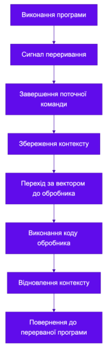

# лекція 10

##1

вона точно точно була не підглянута в лекції, чесно чесно)

##2

| ситуація | тип | чому |
|---|---|---|
| користувач натиснув клавішу | апаратне переривання | сигнал приходить ззовні від периферійного пристрою, тобто клавіатури, і асинхронно |
| ділення числа на нуль | виняток | помилкова ситуація під час виконання самої команди |
| зупинка на точці зупинки в дебагері | пастка | подія навмисно викликана процесором для покрокового налагодження |

винятки і пастки є внутрішніми перериваннями, а клавіатура - зовнішнім

##3

обробник переривання повинен виконуватись якомога швидше

на час його роботи інші переривання з тим самим або нижчим пріоритетом можуть бути заблоковані

довге читання з диска затримало б обробку цих подій того вони чекали б завершення обробника, а це може призвести до втрати даних або до зависання системи

переривання з вищим пріоритетом можуть перервати обробник, якщо дозволені вкладені переривання

типова практика - виконати в обробнику мінімум дій, а решту роботи передати відкладеному завданню, яке виконається пізніше в звичайному режимі
